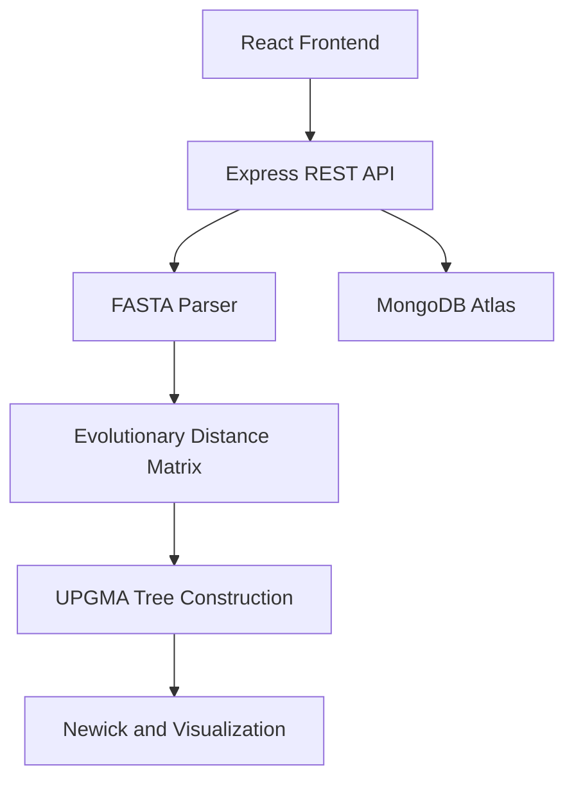

# Phylogenetic Paradox Engine

A full-stack computational workspace for molecular evolution,
DNA sequence comparison, and phylogenetic analysis.

Developed by Xavier Moorkattil.

## Overview

The Phylogenetic Paradox Engine examines patterns of shared
evolutionary ancestry using computational methods in bioinformatics.

It calculates evolutionary distances between DNA sequences,
constructs rooted phylogenetic trees using UPGMA, and preserves
analysis results with scientific provenance.

## Live Application

https://phylogenetic-paradox-engine.onrender.com

The hosted research workspace requires authentication.

## Technology Stack

| Layer | Technology |
|---|---|
| Frontend | React, Vite, CSS |
| Backend | Node.js, Express.js |
| Database | MongoDB Atlas |
| Testing | Node.js Test Runner |
| Version Control | Git and GitHub |
| Hosting | Render |

## Features

- DNA sequence validation
- FASTA parsing
- Ordinary and aligned p-distance calculations
- Pairwise evolutionary distance matrices
- UPGMA tree construction
- Interactive phylogenetic tree visualization
- Newick tree representation
- Scientific analysis provenance
- SHA-256 input fingerprints
- Persistent analysis storage
- Analysis retrieval and deletion
- HTTP authentication
- API rate limiting
- Security headers

## Architecture



## Local Installation

Prerequisites:

- Node.js 24
- npm
- Git
- MongoDB Atlas account for MongoDB persistence

Clone the repository:

```bash
git clone https://github.com/XAVIER-MOORKATTIL/phylogenetic-paradox-engine.git
cd phylogenetic-paradox-engine
```

Install dependencies:

```bash
npm ci
npm --prefix client ci
```

Create a private `.env` file using `.env.example` as a template.

For local file-based storage:

```dotenv
NODE_ENV=development
PORT=3000
ANALYSIS_STORAGE_BACKEND=file
```

For MongoDB persistence, configure your own private
`MONGODB_URI` and database name.

Build and start the application:

```bash
npm run build
npm run start:local
```

Open http://localhost:3000 in your browser.

## Automated Testing

```bash
npm test
```

The application has passed 185 automated tests covering
sequence validation, FASTA parsing, evolutionary distances,
UPGMA, Newick conversion, provenance, persistent storage,
REST API endpoints and security middleware.

Run the frontend checks:

```bash
npm --prefix client run lint
npm run build
```

## API Endpoints

| Method | Endpoint | Purpose |
|---|---|---|
| GET | /api/health | Application health |
| POST | /api/analyze | DNA sequence analysis |
| POST | /api/analyze/aligned | Aligned sequence analysis |
| POST | /api/analyze/fasta | FASTA analysis |
| GET | /api/analyses | List saved analyses |
| GET | /api/analyses/:id | Retrieve an analysis |
| DELETE | /api/analyses/:id | Delete an analysis |

## Security

Keep all genuine credentials in a private `.env` file
or the hosting provider's environment settings.

Never commit passwords, connection strings or secret
tokens to the Git repository.

This application is an educational research workspace,
not a multi-user production authentication platform.

## Scientific Limitations

UPGMA assumes approximately constant evolutionary rates.

The inferred trees represent computational hypotheses,
not definitive proof of biological ancestry.

Synthetic sequences are provided for demonstration and
software validation, not as authentic biological evidence.

Common ancestry is not direct ancestry.

## Author

Xavier Moorkattil

B.E. Electronics and Telecommunication Engineering

Independent Researcher

## Project Status

Functional full-stack application deployed on Render,
with MongoDB Atlas persistence and automated testing.

Security remediation and scientific validation
remain ongoing responsibilities.